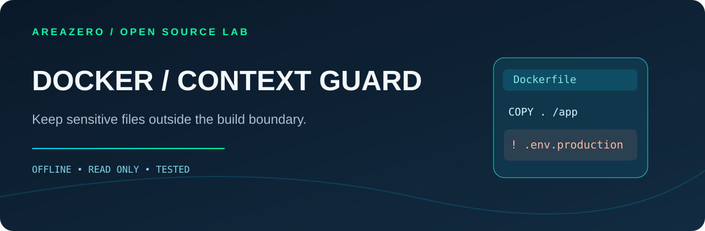

<p align="center"></p>
<p align="center"></p>

# Docker Context Guard

**Know what enters your Docker build context — without opening the secrets.** A read-only, dependency-free Agent Skill for Claude Code, Codex and maintainers reviewing container image build pull requests. Finds accidental inclusion of secret-like filenames, broad COPY, `.dockerignore` ordering mistakes and build secrets passed through ARG/ENV.

[](https://github.com/Kanompung1988/docker-context-guard/actions/workflows/ci.yml) · [Agent Skills spec](https://agentskills.io/specification) · [Rule reference](references/RULES.md) · [MIT source license](LICENSE)

## Why this exists
Docker sends build-context files to the builder and `COPY`/`ADD` can include them in layers. Docker's `.dockerignore` can exclude unintended inputs, but per-Dockerfile rules, negation order and broad COPY affect what is sent. Docker explicitly warns against using `ARG` and `ENV` for build secrets; use secret mounts instead. This tool focuses on reviewable evidence from input names, not guessing values.

## Quickstart

```bash
git clone https://github.com/Kanompung1988/docker-context-guard.git
cd docker-context-guard
python scripts/audit.py examples/unsafe --format markdown --fail-on none
python scripts/audit.py /path/to/docker-build-context --format json --fail-on high
# 0 = below threshold, 2 = findings require review, 1 = invalid input
```

### Install in agent workspace

```bash
# Claude Code (project-local)
mkdir -p .claude/skills
git clone --depth 1 https://github.com/Kanompung1988/docker-context-guard.git .claude/skills/docker-context-guard
# Codex (project-local)
mkdir -p .agents/skills
git clone --depth 1 https://github.com/Kanompung1988/docker-context-guard.git .agents/skills/docker-context-guard
```

Ask an agent: *"Before shipping this Docker image, inspect the build context and .dockerignore. Explain the risks with paths and safe alternatives, without reading secrets or running docker build."*

## Example findings (synthetic fixtures)

```text
HIGH   DC001 Dockerfile:2  Secret-like ARG variable name: NPM_TOKEN
HIGH   DC003 Dockerfile:1  No .dockerignore found for a broad context COPY/ADD.
HIGH   DC005 .env.production:1  Sensitive-looking filename is included in Docker build context.
MEDIUM DC002 Dockerfile:5  Broad COPY/ADD may include unintended context files.
MEDIUM DC004 .dockerignore:1  .git directory may enter the build context.  (covered by a synthetic regression test)
```

These are examples of the **bundled synthetic fixture**, not claims that any real tokens leaked. The scanner never reads `.env` or private key file contents.

## Architecture and QA
- `scripts/audit.py`: inspect Dockerfiles and `.dockerignore` only; gather metadata about filenames; apply ordered ignore rules (subset); produce JSON/Markdown.
- `tests/test_audit.py`: regression cases covering broad COPY, multi-line ENV, Dockerfile-specific ignore precedence, negation ordering, symlinks and CLI return codes.
- `examples/{safe,unsafe}`: benign synthetic directories; safe fixtures use placeholder configuration only.
- `.github/workflows/ci.yml`: standalone Python 3.10/3.12 test matrix with a smoke run.

```bash
python -m unittest discover -s tests -v
python scripts/audit.py examples/unsafe --format json --fail-on none > /tmp/docker-context.json
```

## Scope and license
Static rule-based metadata scan only; it does not emulate the full Docker Go patternmatcher, BuildKit semantics, remote contexts, multi-stage output, `RUN` behavior or runtime image history. No finding does **not** establish absence of leaked secrets. See [rules](references/RULES.md) and [primary Docker docs](references/SOURCES.md). Original code/docs © 2026 AREAZERO Skill Lab are MIT-licensed. The official Area Zero logo is owned by its rights holder and **excluded from the MIT code license**.
